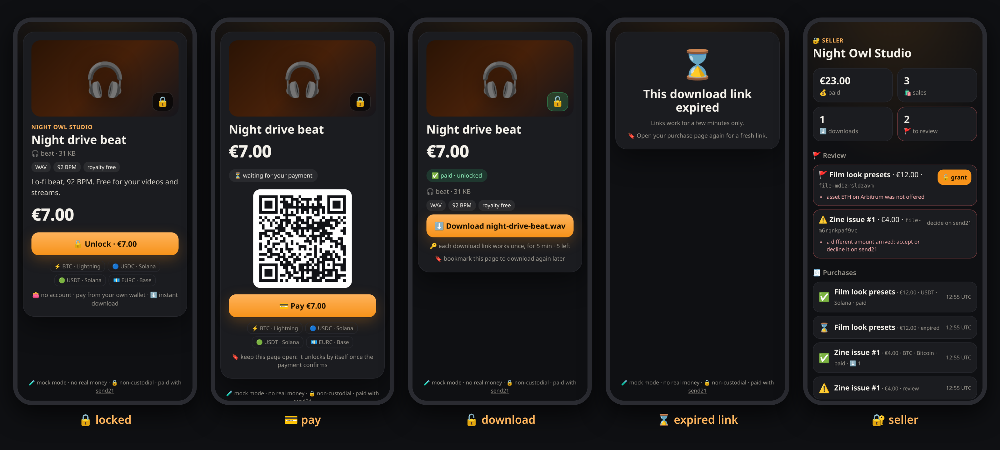
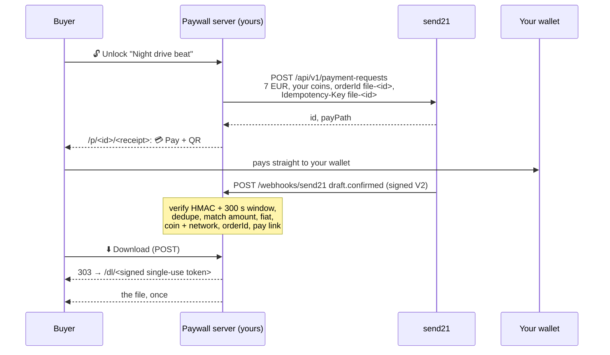

# send21 file paywall 🔒

**Sell a file (a beat, a preset pack, a zine, a zip) from a tiny dark sales page: 🔒 preview, price, 💳 pay, ⬇️ download.** Built on [send21](https://send21.io), crypto pay links and API for people and AI agents.

<p></p>

<sub>Mock-mode screenshots, not real payments.</sub>

- 💳 One send21 pay link per purchase, priced in fiat: buyers pay in BTC (on-chain or ⚡ Lightning), USDC, USDT, EURC, SOL or ETH, whichever you add
- 🔓 The download unlocks only after **your** server checked the payment, through a signed, single-use link that lasts a few minutes
- 🔒 Non-custodial: the money goes from the buyer's wallet straight to yours. Files stay in a private folder, never in `public/`

## Quickstart

1. **Try it now, no keys:** `npm install && npm run dev`, open http://localhost:3000. Mock mode makes three sample files: 🔓 unlock one, tap 💳 Pay, press ✅ pay on the mock page, and the purchase tab unlocks by itself. Also try ⚠️ short → 👍 accept / ↩️ decline, 🚩 wrong coin or ⌛ expire. Seller view: http://localhost:3000/seller/demo.
2. **send21 key.** On [send21.io/api-keys](https://send21.io/api-keys), create a key with `drafts:write` (add `webhooks:manage` for step 4).
3. **Configure.** `cp .env.example .env`: the key, `PUBLIC_URL`, your own receiving addresses (`PAY_LIGHTNING=you@your-wallet.com`, `PAY_OPTIONS=usdc-sol:<address>`), and two secrets: `DOWNLOAD_SECRET` and `SELLER_TOKEN` (`openssl rand -hex 32`).
   - 🔐 **Approve your receiving addresses in send21.** New send21 accounts (created on or after 20 Oct 2026) only accept receiving addresses the owner approved, including Lightning addresses. Add them in the send21 app, or propose one from an agent (MCP `propose_receiving_address`), then sign in and approve it with a passkey or authenticator code. No API key can approve an address. Older accounts can opt in under Settings.
4. **Webhook.** Put the server behind your own HTTPS address (for example a reverse proxy with a free Let's Encrypt certificate and `TRUST_PROXY=1`), then `npm run webhook:register` and paste the printed `SEND21_WEBHOOK_SECRET` into `.env`.
5. **Add your files and go.** `npm run file:add -- ./night-drive.wav --title "Night drive beat" --price 7 --tags "WAV,92 BPM"`, then `npm run build && npm start`. Share `https://your-site/f/<slug>`.

## How it works

🔓 **Unlock** creates a purchase with a random id and a 256-bit receipt key, then **one** send21 payment request: priced in fiat, your coins, `orderId` `file-<id>` that is also the `Idempotency-Key`. The buyer lands on `/p/<id>/<receipt key>` (only the key's hash is stored), with a 💳 Pay button and a QR. They pay on send21 in a new tab; the purchase page checks its status every few seconds.



| Webhook | Purchase | Download? |
| --- | --- | --- |
| `draft.seen` | 👀 seen | no |
| `draft.confirmed`, matches the purchase | ✅ paid | **yes** |
| `draft.confirmed`, does **not** match | 🚩 flagged for the seller (reasons listed) | no, until the seller 🔓 grants it |
| `draft.amount_mismatch` → `mismatch_accepted` / `mismatch_rejected` / `mismatch_unresolved` | ⚠️ review → 👍 / ↩️ declined / 🚩 unresolved | only after a matching `draft.confirmed` (or a 🔓 grant for unresolved) |
| `payment_request.expired`, `draft.expired` | ⌛ expired (a late exact payment still unlocks) | no |

**Download links.** `dl1.<purchase>.<jti>.<exp>.<HMAC>`: signed with `DOWNLOAD_SECRET` over the purchase, a random id, the expiry, the file's slug and its SHA-256. A link is minted only by a POST from the unlocked purchase page (so chat-app link previews cannot burn it), works **once** (marked used in the same write that checks it, before the first byte) and expires after `DOWNLOAD_TTL_SECONDS` (300). A buyer gets `DOWNLOAD_LIMIT` (5) links in total. Replacing a file voids old links.

**🔐 Seller view** (`/seller`, `SELLER_TOKEN`): sales, downloads, purchases, and a 🚩 review list. Amount mismatches are accepted or declined on send21; flagged or unresolved purchases can be unlocked by hand with 🔓 grant after you checked your wallet.

**⚡ Lightning.** send21 fetches an invoice from your Lightning address and confirms the payment when your wallet provider supports **LUD-21**. Without it the money still reaches you, but the download does not unlock on its own. See [Lightning](https://send21.io/docs/lightning).

**Fees.** One small send21 fee per paid purchase (0.49% on small payments, at least $0.01), never taken from the payment. See [pricing](https://send21.io/pricing).

## Troubleshooting

- **422 `address_not_approved`:** a receiving address isn't approved in your send21 account, so nothing was created. Sign in to send21, approve the address (passkey or authenticator code), then try again.

## Security notes

- **Signature V2 only.** Every delivery is checked with `X-Send21-Signature-V2`: HMAC-SHA256 over `<t>.<delivery id>.<raw body>`, constant-time compare, refused when more than **300 s** old or in the future. A bad signature gets `401` and nothing is stored.
- **The receiver dedupes deliveries.** send21 does not dedupe deliveries. Retries reuse the same `X-Send21-Delivery` id, and the receiver ignores deliveries it already handled: a delivery id, or the same body under a new id, is applied once. Separately, the `Idempotency-Key` makes one purchase one link. The delivery id and the purchase change are written together before the `2xx`, so a restart cannot apply it twice; a failed write answers `500` so send21 retries.
- **Exact match or no download.** A `draft.confirmed` must match the stored purchase: `orderId`, pay link id, `status: Confirmed`, a txId, the fiat currency, the exact price (in cents) and a coin **and** network that purchase offered. Anything else is 🚩 for the seller, never unlocked automatically. Paid is final. Other apps' orders on the same send21 account are ignored.
- **No guessable URLs.** Purchase pages need a 256-bit receipt key (stored only as a hash). Download links are HMAC-signed, single-use and short-lived. Files live in `FILES_DIR`, are checked to be regular files inside it (no `..`, no symlinks out), and are only ever sent by `/dl/<token>` with `Content-Disposition: attachment` and `Cache-Control: no-store`.
- **Seller login.** One token, compared in constant time, rate-limited; the session cookie is HMAC-signed, `HttpOnly`, `SameSite=Strict`, `Path=/seller` (and `Secure` on https). Seller POSTs also check `Origin` and `Sec-Fetch-Site`.
- **Hardened pages.** Strict CSP (`'self'`, no inline script or style), `frame-ancestors 'none'`, `Referrer-Policy: no-referrer`, tiny body limits, unlocks rate-limited per IP. The API key is never logged and cannot move funds; send21 never asks for a seed phrase or private key.
- **Data.** One JSON file (`DATA_FILE`, mode 600), written atomically. For several processes, use SQLite or Postgres.

## Develop

```bash
npm run check   # typecheck + lint + tests: signature, dedupe, restart, matching, tokens, single use, expiry, seller, mock flows
```

API reference: [send21.io/docs](https://send21.io/docs) · [quickstart](https://send21.io/docs/quickstart) · [webhooks](https://send21.io/docs/webhooks) · [llms-full.txt](https://send21.io/llms-full.txt). More examples: [send21-examples](https://github.com/send21io/send21-examples).

Questions: [info@send21.io](mailto:info@send21.io). License: [MIT](LICENSE).
